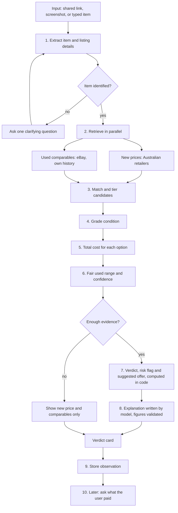

# System pipeline

The steps a single check goes through, from the user's input to the stored result. Detail, cost arithmetic and alternatives are in `research/findings/05-technical-architecture.md`. Cost and latency figures here are that track's estimates; nothing has been built or measured yet.

## Steps

| # | Step | How | Output |
|---|---|---|---|
| 1 | Extract | A small vision-capable model reads the screenshot or the shared text into a fixed structure. Pages are fetched only for eBay and retailer links; Marketplace and Gumtree listings come in as screenshots, which are discarded after extraction | Category, brand, model, variant, bundle contents, asking price, stated condition, suburb, and how confident the identification is |
| 2 | Retrieve | Connectors run in parallel behind a common interface: new prices from the route chosen in Phase 1; used asking prices from eBay's official API, only once eBay has confirmed in writing that this use is permitted; the app's own stored observations | Candidate offers, each with source, link, price and time |
| 3 | Match and tier | Hard rules (brand must match, price within a sane band), then one batched small-model call that labels each candidate same / same family, different variant / substitute / different, with the differences | Tiered candidates. Bundles are split into components so a combo is never compared with a rod-only price |
| 4 | Grade condition | Seller's stated condition where structured; otherwise a model reading of the text and one or two photos, on a five-point scale | Grade, confidence, and the phrases that drove it |
| 5 | Total cost | In code: price + shipping + travel + optional time cost + an allowance for buying privately − the value of warranty and returns on retail purchases. Every term is visible and adjustable | Comparable total for each option |
| 6 | Fair used range | In code, from the strongest evidence available: sold prices if licensed, then asking prices for the same item, then percent-of-new from a table by category and condition. That table is hand-built from the labelled test cases and shown as an assumption. At launch, and without eBay, it is the main basis. Three confidence levels tied to the number of comparables, match tier and age of data | A range, never a single figure, with the evidence count |
| 7 | Verdict | In code, from thresholds on the listing's total cost against the fair range and the best new total. A suggested offer is computed the same way. A price far below the range gets a "too cheap, check carefully" risk flag instead of a buy verdict | Buy / negotiate / skip, a risk flag, or "not enough data" |
| 8 | Explain | A stronger model receives the evidence pack with an identifier on every figure and writes three reasons and any caveats. A validator rejects any figure not in the pack; on failure, regenerate once, then use a template | Text for the verdict card |
| 9 | Store | Item, price, condition, suburb-level location, date, sources and the verdict. No seller name, face or profile link | A row in the price-observation history |
| 10 | Follow up | A few days later: "Did you buy it? For how much?" | An outcome price, the data nobody outside the platforms has |

## The verdict card

- Verdict and confidence level, with the reason in one line.
- Risk flags where they apply, worded as things to check. The card never says a listing is safe.
- New price: the best current price, the retailer, the time it was checked, and a link.
- This listing as a percentage of new.
- Fair used range and how many comparables it rests on.
- Comparable listings, with eBay results in their own section.
- Total cost: this listing including travel, against the best new option delivered.
- Suggested offer and a draft message to the seller.
- What to inspect before paying, for this category.
- Which sources were checked, and which links earn the app a commission.

## Expected cost and speed

The figures are in US dollars; the business thresholds are in Australian dollars, and a US dollar is worth more than an Australian one. At roughly A$1.50 to the US dollar (an assumption to check), US$0.05 is about A$0.075.

| Design | Cost per check | Time to answer |
|---|---|---|
| This pipeline, stronger model for the explanation | about US$0.05 | first results in 2–4 s, complete in 6–10 s |
| This pipeline, small model throughout | about US$0.02 | similar |
| A model agent doing its own web search (fallback for obscure items) | US$0.09–0.45 | 30–90 s |

The new-price lookup in these estimates is a call to a search-results vendor, which the legal track rates as grey and fragile for production use. Affiliate feeds would cost nothing per call but are not yet confirmed for any retailer.

Retrieval calls, at roughly one US cent each, cost more than the model in the cheap design. Caching new prices per product for 6–24 hours cuts that in proportion to how often items repeat.

## Build notes

- All vendor calls sit behind interfaces, so a search provider or model can be swapped without touching the pipeline.
- Keys stay on the server. Per-user rate limits from the first day.
- A check is a multi-step job that outlives a single request; run it in a durable job runner and stream progress to the app.
- The golden set from Phase 2 runs on every change to prompts, models or thresholds.
