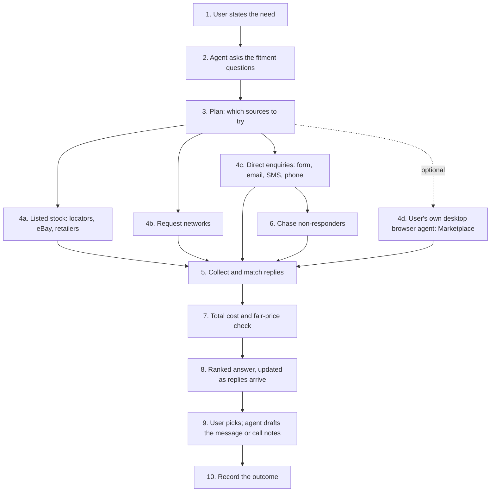

# System pipeline

Revised after the third pass. The product is now a sourcing agent: the user states a need, the agent does the searching and asking, and returns one ranked answer. The fair-price check from the earlier design is stage 7.

Cost and timing figures are estimates from the research tracks. Nothing has been built or measured.

## Stages

| # | Stage | What happens | Timing |
|---|---|---|---|
| 1 | State the need | "Rear drive shaft for a 2012 Hilux", typed, spoken or as a photo of the part or the old one's label | User: under a minute |
| 2 | Fitment questions | The agent asks what a wrecker would ask: registration or VIN, engine, transmission, drive type, part number if visible. It stops when the part is pinned down, and says so when it cannot be | User: one to three minutes |
| 3 | Plan | Chooses sources by part type, vehicle age and the user's location and budget | Seconds |
| 4a | Listed stock | Searches stock that suppliers publish: the locator services, eBay through its partner API, new and aftermarket retailers | Minutes |
| 4b | Request networks | Lodges the request with the existing Australian parts-request services, as the user would | Replies in an hour or more |
| 4c | Direct enquiries | Sends a short, specific enquiry to yards not reached above, by whichever channel each one answers: web form, email, SMS or a phone call. It says it is an assistant acting for a buyer, asks only for price, condition and availability, and never promotes the product | Replies over hours; many will not reply |
| 4d | Marketplace, optional | For users who already run a browser agent on their own computer, the product supplies instructions for searching Facebook Marketplace and Gumtree in their own session and reads back what it found. Never part of the phone app, never from the product's servers | Minutes, on desktop only |
| 5 | Collect and match | Reads each reply or listing into the same structure and labels it: correct part, compatible alternative, wrong, or unclear | As replies arrive |
| 6 | Chase | Follows up once with suppliers who have not answered, then stops | After a set interval |
| 7 | Total cost and fair price | In code, for each option: price, freight or travel, warranty offered, and the new-part price for comparison. Flags an offer that costs more than new | Seconds |
| 8 | Ranked answer | A first answer from listed stock within minutes, then a notification as better options arrive. Each option shows who, where, price, condition, warranty and how sure the fitment is | First answer in minutes; fuller answer within a working day |
| 9 | Hand over | The user chooses. The agent drafts the message or gives call notes. It does not pay or commit on the user's behalf | User: a minute |
| 10 | Record | What was bought, from whom and for how much; which suppliers replied and how fast | Builds the supplier-response and price history |

## What the model does and does not do

- The model reads requests and replies, asks questions, matches parts and writes messages.
- Code computes every price, total and ranking from what was retrieved. A validator rejects any figure that does not trace to a reply or listing.
- "I could not confirm this fits" is a valid output. A wrong part costs the user more than no answer.

## Data sources by tier

| Tier | Sources | Status |
|---|---|---|
| Open to approved partners | eBay Browse API; Amazon Australia API | eBay production access is by partner application; Amazon needs 10 sales in 30 days. Neither's data may be stored long-term |
| Published by suppliers | Locator services' searchable stock; retailers' own sites | Access terms to be agreed with each; no partnership exists yet |
| Reached by asking | Wreckers and yards by form, email, SMS, phone | Lawful on a first reading; needs a lawyer's view on the enquiry wording |
| User-side only | Facebook Marketplace and Gumtree through the user's own desktop agent | Forbidden by those platforms' terms for their users; optional, at the user's risk |
| Not used | Any marketplace from the product's servers; users' passwords | — |

## The asset that builds up

Stage 10 records which suppliers answer, how fast, on which channel, and what parts actually cost. That response map is what a newcomer would lack, and what makes later requests faster. It contains business contact behaviour and prices, not personal data about sellers.

## Expected cost

- A search of listed stock with a fair-price check: about US$0.02–0.07, by the architecture track's estimate.
- Each direct enquiry adds a message or call. An SMS or email costs cents; an AI voice call costs more and was not priced.
- A request that contacts twenty yards might cost A$1–3 in total. That is my own rough estimate, to be replaced by measurement.
- Against that, a completed parts purchase might support about A$10 in referral or finder's fee, by one track's rough arithmetic.
